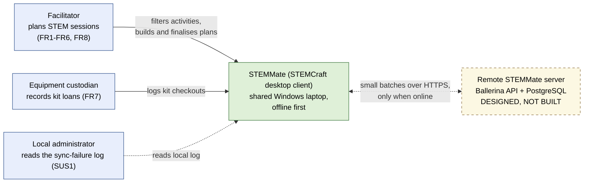
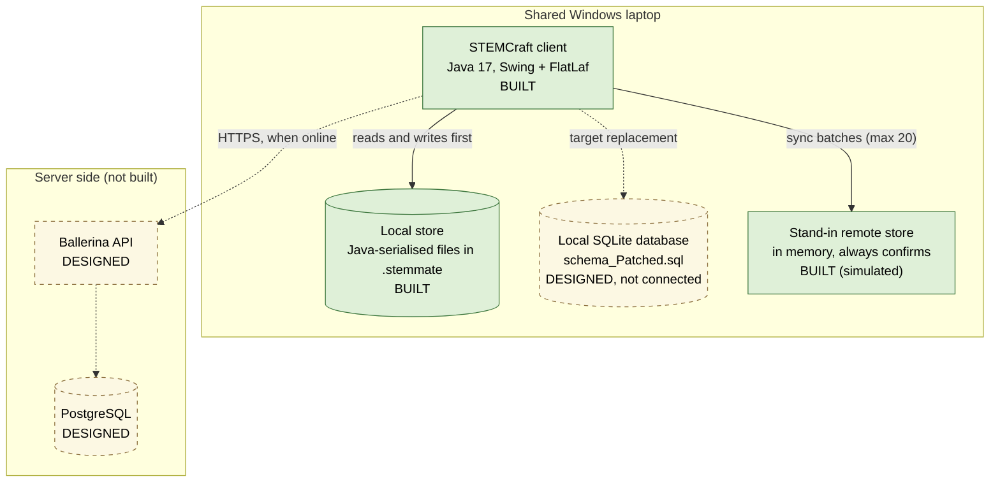
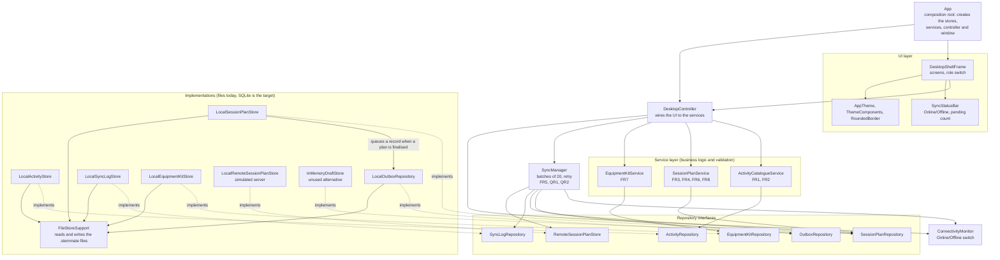
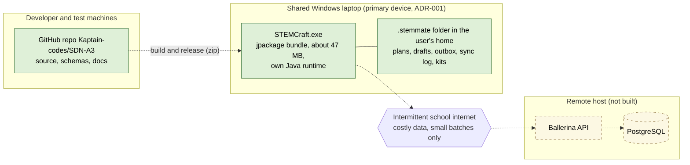

# Architecture views (A4)

These diagrams render on GitHub. The editable sources are the .mmd files in this folder. Green solid = built; yellow dashed = designed only; blue = person. See README.md for purposes and requirement links.

## View 1: System context

- View 1: System context. Purpose: show who uses STEMMate and what sits outside it.
- Requirements: FR1-FR8 (facilitator), FR7 (custodian), SUS1 (administrator), PR rule: no learner data.
- Legend: green solid = built; yellow dashed = designed only; blue = person; dashed arrow = not built or optional.
- Constraints: intermittent internet, costly data, shared low-spec laptops, limited support. No learner data is stored.

## View 2: Containers

- View 2: Containers. Purpose: show the main runnable parts and what each stores or calls.
- Requirements: FR2, FR5, FR6, QR1, QR2, SUS1. ADR-001 (laptop first), ADR-002 (Java + Swing), ADR-003 (storage, Role 4 package, section 4).
- Legend: green solid = built; yellow dashed = designed only.
- Note: the stand-in store always confirms, so the failure path cannot be shown yet (A3 finding F2).

## View 3: Components (inside the client)

- View 3: Components inside the STEMCraft client. Purpose: show layers and dependencies.
- Requirements: FR1-FR8, QR1 (local first), SUS1 (sync log). Arrows checked against the imports and App.java at commit 28fef52.
- Legend: solid arrows point from a class to the class it uses; dashed arrows mean "implements".
- Note: SessionPlanService depends only on SessionPlanRepository; the outbox record is created inside LocalSessionPlanStore, which uses the concrete LocalOutboxRepository.
- Gap: few accessible names are set in the UI (AC1); there is no sign-in or close warning (QR2).

## View 4: Deployment

- View 4: Deployment. Purpose: show where each part runs and over what link.
- Requirements: QR2 (low-spec shared devices, costly data), SUS1 (local support), QR1 (data stays local until confirmed).
- Legend: green solid = built; yellow dashed = designed only; hexagon = network link.
- Delete the .stemmate folder to reset the demo. No sign-in, so anyone on the laptop account can read the plans (A3 pain point 4).

